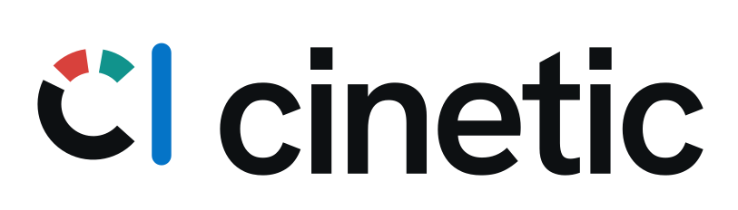

<h1 align="center">
  <picture>
    <source media="(prefers-color-scheme: dark)" srcset="docs/brand/lockup-dark.svg">
    
  </picture>
</h1>

<p align="center">Cinematic launch films and motion design from code, directed by your coding agent.</p>

<p align="center">
  <a href="LICENSE"></a>
  <a href="#install"></a>
  <a href="https://github.com/Leonxlnx/cinetic/releases/latest"></a>
</p>

<p align="center">
  <a href="https://raw.githubusercontent.com/Leonxlnx/cinetic/media/kiln-launch-teaser.mp4"></a>
</p>

<p align="center">Kiln: a 25-second launch teaser that an agent branded, directed, scored and rendered from a two-sentence brief. The GIF is an excerpt; click it to download the full 1920x1080, 60 fps MP4 with sound (7 MB).</p>

cinetic (cinema + kinetic) is an agent skill that makes your coding agent direct a short film instead of arranging animation components.

- **Idea first.** Before any code, the agent writes three concepts through different lenses, tests them, and picks one story device the film owns.
- **273 techniques, drawn at random.** A library of measured moves in 14 categories, each with a build recipe and timing at 60 fps. `pick.py` draws the film's plan, weighted for its format and energy, so two films don't share the same fade-up, push-in and end card.
- **Its own brand.** The look comes from three personality words, so a calm notes app and a fast CI tool don't end up looking alike.
- **Calm, with words in fragments.** Copy arrives a few words at a time, split around what the product does ("here is the newest" → the product → its name), with readable holds that drift instead of freezing and stretches of pure picture between. The fragment grammar comes from a frame-by-frame study of eight professional films; a crisp profile is there when a brief asks for energy.
- **One beat grid, measured sound.** `timeline.ts` drives the picture, the soundtrack and the QA scripts, so every hit lands on its frame. The effects come from an [earshot](https://github.com/Leonxlnx/earshot) sound kit: sounds designed in code and rendered with measured sync points, one soft sound per text fragment, one clean element on the lockup. Typing, clicks and ticks follow measured norms of top-tier launch films: soft, short and mostly left to the picture.
- **Finished and measured.** True motion blur, no banding, BT.709 and a sync-checked mux, then pixel forensics, an audio-sync audit, contact sheets and critic passes against a ship gate.
- **No generated look.** Hard bans, enforced by a linter and the critics, keep out the looks that mark a video as generated. A brand you supply always wins.

It builds with Remotion (React) by default, or HyperFrames (HTML and GSAP).

[Quick start](#quick-start) · [Gallery](#gallery) · [Technique library](#the-technique-library) · [Install](#install) · [Requirements](#requirements) · [Use](#use) · [How it works](#how-it-works) · [Hard bans](#hard-bans) · [What's inside](#whats-inside) · [Evaluation](#evaluation)

## Quick start

```bash
npx skills add Leonxlnx/cinetic
```

Then ask your agent for a film, for example: "Make a 20-second launch teaser with sound for our database branching tool. Invent the brand." It works with Claude Code, Codex, Cursor and the other agents the skills CLI supports.

Before the first film, check your machine with [a first test render](docs/setup.md#4-a-first-test-render). It needs Node 22+, ffmpeg 6+, Python 3.11+ and a headless Chromium; see [Requirements](#requirements).

## Gallery

<table>
<tr>
<td rowspan="2" width="260" valign="top">
<a href="https://raw.githubusercontent.com/Leonxlnx/cinetic/media/quire-streaks-vertical.mp4"></a>

**Quire Streaks.** A 12 s vertical video for Reels and TikTok, in the brand the brief supplied. A blue thread stitches each day's pages into the Streaks screen, one rising note per stitch. On Sunday at 11:41 pm the thread hangs loose until one tap on Log pulls it tight, and the week gathers into a quire, the bookbinding word behind the name. [Download MP4 (1080x1920, sound, 1.4 MB)](https://raw.githubusercontent.com/Leonxlnx/cinetic/media/quire-streaks-vertical.mp4)

</td>
<td valign="top">
<a href="https://raw.githubusercontent.com/Leonxlnx/cinetic/media/ledgerly-feature-loop.mp4"></a>

**Ledgerly Auto-Split.** A 10 s silent loop for a landing page. The bill starts split evenly at 53.55 each; Auto-Split tags each line with who ate it, fans the receipt out into four and trims each copy to that friend's dishes, shared ones divided only among the people who shared them. "Jonas only had salad." [Download MP4 (1920x1080, loop, 2 MB)](https://raw.githubusercontent.com/Leonxlnx/cinetic/media/ledgerly-feature-loop.mp4)

</td>
</tr>
<tr>
<td valign="top">
<a href="https://raw.githubusercontent.com/Leonxlnx/cinetic/media/halden-logo-sting.mp4"></a>

**Halden.** A 6 s logo sting for a calm note-taking app, mixed at −16 LUFS, plus four ProRes 4444 alpha versions (held and cleared, for light and dark footage). The app's text cursor settles into a dot, and the h draws its arch over it like a fermata, the musical sign for "hold". [Download MP4 (1920x1080, sound, 0.3 MB)](https://raw.githubusercontent.com/Leonxlnx/cinetic/media/halden-logo-sting.mp4)

</td>
</tr>
</table>

All four films were made by an agent with development snapshots of cinetic 1.0.0, in evaluation rounds 6 (Kiln) and 7 (the others), from the one-paragraph briefs below, the same briefs used in the [evaluation](#evaluation). The brands are invented, except where the brief supplied one. Clicking a GIF downloads its MP4. The films live on the repo's `media` branch, so installs stay small.

<details>
<summary>The four briefs, word for word</summary>

**Kiln launch teaser**

> Invent the brand for Kiln (a build cache that makes CI runs finish in seconds) and make a 25-second launch teaser with sound for our announcement on X. It should feel like a well-funded company shipped it, not a template.

**Quire Streaks vertical video**

> Our reading-tracker app Quire is shipping Streaks next week. Make a 12-second vertical product video (1080x1920, for Instagram Reels and TikTok, with sound) showing how a reading streak builds over a week. Use our brand: ink #1B1B1F, paper #FBF7F0, accent #3E7BFA, typeface Manrope.

**Ledgerly feature loop**

> Make a 10-second looping feature animation for the landing page of Ledgerly, a shared-expenses app. It should show the new Auto-Split feature splitting a dinner bill between four friends. 1920x1080, it has to loop seamlessly and work without sound (it autoplays muted on the site).

**Halden logo sting**

> We're launching Halden, a calm note-taking app. Design the logo and make a 6-second logo sting with sound that we can put at the start of our videos, plus a transparent version for our editors.

</details>

## The technique library

An agent left to choose picks the familiar option every time. cinetic's agent draws instead. In Step 1, after it has chosen a concept, it runs:

```bash
python3 scripts/pick.py --format launch --energy high --seconds 25 --json out/qa/picks.json
```

and gets about one technique per 3.5 s of film at the calm default and per 2.5 s for an energetic one (7 or 10 for a 25 s launch, 5 for a 12 s vertical video, 4 for a loop or a sting), drawn in the order the format needs them and weighted toward proven workhorses and the film's energy. Each pick prints its build recipe and default timing. The agent builds the picks its concept can carry, retold in the film's own objects, and rerolls or drops the rest with a reason written into the treatment; it never adds a move the draw didn't give it. The seed is printed, so a plan can be reproduced.

| Category | Entries | | Category | Entries |
|---|---|---|---|---|
| Opening hooks | 10 | | Logo and end card | 18 |
| Transitions | 22 | | Colour and light | 25 |
| Camera | 22 | | Texture and finish | 20 |
| Typography in motion | 25 | | Layout and composition | 16 |
| UI choreography | 19 | | Pacing and structure | 23 |
| Data and numbers | 17 | | Micro-interactions | 20 |
| Product demo | 22 | | Depth and 3D | 14 |

<details>
<summary>An example entry</summary>

**Velocity handoff cut** (`tr-velocity-handoff-cut`)
*transition · workhorse · energy any · formats any*

The outgoing shot speeds up in one direction and is cut on its fastest frame. The next shot opens already moving the same way and brakes to rest, so momentum runs straight through the edit.

**Build:** Make the cut an act boundary in timeline.ts so motion-blur samples never straddle it, and place it on a beat with b(). In the outgoing act, drive the camera (src/lib/camera.ts) or the hero's translate on E.exit (E.contact, or E.in for a harder snap) over its last 16-24 f, so it ends at peak speed on the final frame; for a zoom, apply the same ramp to k through lmix. In the incoming act, start the key element moving on frame 0 in the same screen direction at 1.0-1.5x that speed and slow it on E.out over 45-90 f. Size the two sides with exitSpeed(D, T, ease) and entryDistance(v, T) from references/transitions.md; for a flicked list, use y = v0·(1 − k^f)/(1 − k) with k = 0.92-0.943 and no overshoot. Give each act one dominant screen vector (+x in one act, −x in the next) and start every incoming element on the side it would enter from.
**Timing:** Exit: last 16-24 f on E.exit (speed grows about ×1.1-1.2 per frame), ending at 25-40 px/f (never above 60) or −6 to −8% scale per frame. Entry: 30-55 px/f on frame 0, slowing about ×0.92-0.94 per frame (E.out over 45-90 f; entryDistance(40, 60) is about 400 px). A 1-3 px/f drift may run under the hold before the ramp. Text inside a moving shot must be under 20 px/f by the time it has to be read.
**Use when:** Most cuts between moving shots: feature-to-feature edits, montages, chapter changes, and any film that must never stop. Velocity-matched cuts are exempt from the two-uses-per-type limit.
**Avoid when:** One side has to be still (a held statement or a designed freeze), or the two shots would move in opposite directions. Carry a shape or an anchor across instead.

</details>

Every entry was edited for the hard bans: where the full look of a technique relies on glow, glass, a multi-hue gradient or another banned look, the entry carries a ban-safe variant, which is what gets built unless the brand supplies that look. Browse them all in [references/technique-library.md](skills/cinetic/references/technique-library.md). The measured norms behind them (shot lengths, easing, text timing, transitions, camera, UI in motion, colour over time) are in [references/craft-rules.md](skills/cinetic/references/craft-rules.md).

## Install

### Skills CLI (recommended)

```bash
npx skills add Leonxlnx/cinetic
```

Global install for Claude Code, without prompts:

```bash
npx skills add Leonxlnx/cinetic -g -a claude-code -y
```

Pin a version:

```bash
npx skills add Leonxlnx/cinetic#v1.1.0
```

For Claude Code the skill lands in `.claude/skills/cinetic` (project) or `~/.claude/skills/cinetic` (with `-g`). The same command installs it for the other agents the skills CLI supports, such as Codex and Cursor; choose them with `-a`.

### Claude Code plugin marketplace

```text
/plugin marketplace add Leonxlnx/cinetic
/plugin install cinetic@cinetic
```

Claude Code can then load the skill on its own when you ask for a video, because the request matches the skill's description, or you can call it directly as `/cinetic:cinetic`. To update, run `/plugin marketplace update cinetic`, then open `/plugin` > Installed > cinetic > Update now (details in [docs/setup.md](docs/setup.md#claude-code-plugin)).

### Manual

Download `cinetic.skill` from the [latest release](https://github.com/Leonxlnx/cinetic/releases/latest). It is a zip whose top folder is `cinetic/`:

```bash
curl -L -o cinetic.skill https://github.com/Leonxlnx/cinetic/releases/latest/download/cinetic.skill
mkdir -p ~/.claude/skills
unzip cinetic.skill -d ~/.claude/skills/
```

Or copy the folder from a clone (use `<project>/.claude/skills/` instead for a single project):

```bash
git clone --depth 1 https://github.com/Leonxlnx/cinetic
mkdir -p ~/.claude/skills && cp -R cinetic/skills/cinetic ~/.claude/skills/
```

To update a manual install, remove `~/.claude/skills/cinetic` first, then repeat.

## Requirements

- **macOS or Linux.** The scripts are bash (3.2 or newer, so macOS's built-in bash works); they were developed on Linux, and macOS is less tested. On Windows, WSL2 with the [Ubuntu steps](docs/setup.md#ubuntu-and-debian-apt) is the likely route; it has not been tested.
- **Node 22+** (Remotion 4)
- **ffmpeg 6+** with libx264, and ffprobe
- **Python 3.11+** with numpy, scipy, soundfile, pyloudnorm, opencv-python and librosa; fonttools, brotli and uharfbuzz for outlined SVG logos; pillow for banding-free gradient PNGs
- **[earshot](https://github.com/Leonxlnx/earshot) 0.3+ (optional, recommended)** in its own virtual environment, with `EARSHOT_PYTHON` pointing at its interpreter: it renders the film's sound kit and listens to the soundtrack. Without it a film uses the kit takes already rendered in its `audio/kit/`, or falls back to synthesized effects with a warning. Details: [Sound from earshot](docs/setup.md#sound-from-earshot).
- **Chromium or a Chrome headless shell.** Remotion downloads its own if allowed; set `REMOTION_BROWSER` or `CHROMIUM_PATH` to use a local one.
- **A Remotion licence if you need one.** cinetic is MIT, but Remotion, the default engine, has its own licence: free for individuals and companies of up to 3 people, a company licence from 4. HyperFrames is Apache-2.0.

Install the Python packages in a virtual environment:

```bash
python3 -m venv ~/.venvs/cinetic
source ~/.venvs/cinetic/bin/activate
pip install numpy scipy soundfile pyloudnorm opencv-python librosa fonttools brotli uharfbuzz pillow
```

The scripts call plain `python3`, so activate the environment before you start the agent, or put `~/.venvs/cinetic/bin` first on your `PATH` so the agent's shell finds it. A virtual environment also avoids the `externally-managed-environment` error that recent Debian, Ubuntu and Homebrew Pythons raise on a global `pip install`. Details: [Python packages](docs/setup.md#python-packages).

You don't need a Remotion project first: the agent scaffolds one with `scripts/new-film.sh` and installs its dependencies. Renders are CPU-heavy. Motion blur multiplies render time by the number of sub-frames (typically 3–8x a sharp render); `render.sh --blur` prints an estimate before the sub-frame render, and `--budget` caps it. Full setup steps: [docs/setup.md](docs/setup.md).

## Use

Describe the film in a sentence or two. Paste one of these and swap in your product:

```text
Make a 20-second launch teaser with sound for our database branching tool, for the announcement on X. Invent the brand.
```

```text
Animate our new export feature as a 10-second loop for the landing page. It autoplays muted, so it has to read without sound.
```

```text
Design a logo for our budgeting app and make a 6-second sting with sound, plus a transparent version for our editors.
```

```text
Make a 15-second vertical video (1080x1920) for Reels and TikTok showing how shared folders sync. Use our brand: ink #101418, paper #FFFFFF, accent #0F9D76, typeface Figtree.
```

```text
Make a 45-second walkthrough of our onboarding flow, with captions. Rebuild the screens from our React components.
```

```text
Make 9:16 and 1:1 versions of the launch film for Reels and LinkedIn.
```

```text
Review this Remotion film: find the weakest three seconds, check the sync and fix what fails.
```

**What the agent does.** If the brief names the product, the message and the length, it starts; otherwise it asks at most three questions. It works in files you can read and edit: `BRIEF.md` (the spec line, the hard bans and any brand exceptions) and a film project scaffolded from the starter at intake, then `TREATMENT.md` (logline, beat sheet, copy with its word count, mark sheet). It renders style stills and checks them before it animates, critiques previews on contact sheets, and renders the motion-blurred master once, after the last review round. Stings, loops and short clips take a scaled-down path: a one-page treatment, one or two acts and one review round.

**Plan for a long run.** In the last evaluation round, a cinetic run averaged 95 minutes and 626k tokens across the four briefs, about three times the baseline run without it. Most of that goes to building the brand, scoring the sound, rendering motion blur and running review rounds.

**What you get**, by format:

| Format | Length | Deliverables |
|---|---|---|
| Launch film or teaser | 20–45 s | 16:9 master with score and SFX, 9:16 and 1:1 re-layouts, poster, brand kit if invented |
| Product or feature video | 8–30 s | master, poster |
| Feature loop | 4–15 s | MP4, WebM and GIF, with a checked loop seam |
| Logo sting | 3–8 s | MP4 with a tuned hit, ProRes 4444 alpha versions (held and cleared), poster, brand kit if invented |
| UI walkthrough | 20–90 s | master, SRT captions |

Social versions are re-laid out from the same timeline, never cropped from the master. The brand kit for an invented brand holds the mark and lockups as SVG and transparent PNG for light and dark grounds, favicon sizes, a 400x400 avatar and, on request, a 1500x500 header for X. The delivery folder keeps the deliverables at the top level and the QA material (sheets, reports, a manifest with probe facts) in `qa/`. The film stays source code: change a line of copy or the accent and render again.

## How it works

Every step writes a file and ends at a gate the agent actually runs. It starts from `BRIEF.md`, the brief plus a spec line such as `1920x1080@60, 30s, 100BPM, pace: calm, audio: earshot kit (calm), no music`.

| # | Step | Writes | What happens | Key script or template |
|---|---|---|---|---|
| 1 | Idea | `TREATMENT.md` | Three concepts through different lenses; ownership, deletion, specificity and feature-word tests; one story device the film owns; the film's techniques drawn from the library; a beat sheet whose copy is written as fragment chains, each with the picture beat between its fragments | `pick.py`, `assets/TREATMENT.md` |
| 2 | Brand | `src/brand/` | Three personality adjectives set the typeface, stage, accent, corners and motion character; 6–10 mark directions on one sheet, each put through a 64 px misread test; a lockup set like a typographer would | `palette.py` |
| 3 | Timeline | `src/timeline.ts` | FPS, BPM, the beat grid `b(bar, beat, sub)`, acts, cues and every fragment of copy, with words per frame, reading holds and picture beats checked | `grid-check.ts` |
| 4 | Build | `src/acts/` | Acts built from motion tokens and tested primitives (`TypeOn`, `Roll`, `Morph`, `Iris`…), with real product UI fed by one data module; safe zones, covered text and text speed audited | `lint-film.mjs` |
| 5 | Sound | `public/audio/soundtrack.wav` | Sync frames computed from the picture code; the effects from the film's earshot sound kit, placed by measured sync points, with stems; music only when the film wants a groove (none, a supplied track or the synth band); mastered to −14 LUFS with music, −18 effects only; earshot listens to the result | `export-cues.ts`, `kit.py`, `score.py`, `listen.py` |
| 6 | Render | `out/film.mp4` | Preview, sharp or motion-blurred master: optical-flow speeds set the sub-frames per frame, averaged in float and quantized once to BT.709; sync and spec gates | `render.sh` |
| 7 | Review | `out/qa/` | Contact sheets, pixel forensics (pops, stalls, ghosts, judder, banding, loop seams), an onset-by-onset audio audit, four critic lenses and a verifier, a scored rubric and a ship gate | `forensics.py` |
| 8 | Deliver | `out/deliver/` | Poster from a clean still, GIF and WebM loops, alpha stings, social variants, a manifest; the brand kit | `deliver.sh`, `brand-kit.sh` |

Everything hangs off one beat grid. Every frame number in the film comes from one helper, so the picture, the cue export and the audits can't drift apart:

```ts
export const BEAT = (60 / BPM) * FPS;               // 36 f at 100 BPM / 60 fps
export const b = (bar: number, beat = 0, sub = 0) =>   // sub = 16ths
  Math.round(((bar - 1) * 4 + beat) * BEAT + sub * (BEAT / 4));
```

Sounds are never placed by hand. `export-cues.ts` runs the project's `src/sync.ts`, which computes the contact frames of springs, the 50% frame of pop-ins and the velocity peaks of whips from the same constants and springs the acts animate with, and `score.py` writes the score to those frames.

## Sound

Every effect has a role (`text`, `hit`, `land`, `whoosh.short`, `key`, ...), and the film's kit, `audio/kit.json`, names one sound for each from the bank of [earshot](https://github.com/Leonxlnx/earshot), a separate tool that designs sounds in code and checks them by measurement. `scripts/audio/kit.py render` has earshot render the takes into `audio/kit/` with each take's measured onset, loudest point and end, cached; `score.py` puts the onset (a whoosh's peak) on the cue frame, a new take per cue, tonal roles in the film's key. Three presets: `calm` (the default for text-led films: soft taps, a kalimba for text and bells, one struck note for the lockup), `crisp` and `minimal`; every preset leaves risers, swells and sucks off.

The house style is restraint, from a frame-measured study of professional text-led films: one soft sound per text fragment, near-silence while it is read, a big hit only for the one reveal, and a lockup that is a stop-down and one clean element. `score.py` warns on a stacked lockup and on any sound whose pitch climbs. A calm film plays effects only (`"music": "none"`, mastered at −18 LUFS so its accents keep their dynamics); a supplied track or the built-in synth band is one setting away. `scripts/audio/listen.py` gives the review loop ears: earshot's per-cue sync, an annotated sound sheet and a critique, in one process.

The fallback order: earshot renders the kit → the takes already in `audio/kit/` (so a film rebuilds where earshot is not installed) → synthesized effects with a loud warning. The build never fails only because earshot is missing.

## Hard bans

When the agent invents the look, none of these appear:

- **Words:** eyebrow or kicker labels, stacked taglines, "Introducing…", full sentences dumped at once, text walls and filler (decorative mono captions, fake metrics, lorem ipsum)
- **Type:** serif typefaces; italic or oblique styles, including a skew that fakes one
- **Color:** orange, amber, beige, cream, tan or sand; neon, glow, bloom and halos; purple, violet or indigo, and any multi-hue gradient; glassmorphism
- **Decoration:** emoji and stock icons; sparkles standing for "AI", particles, confetti, lens flares and code rain; bouncy overshoot on anything that isn't landing, and any overshoot or per-letter trick on copy

`lint-film.mjs` checks tokens and styles (colors by OKLCH region), `palette.py` refuses a banned accent or paper, and the critics check the rendered frames. What remains is ink and paper, one accent with a meaning from red, green, teal, blue or yellow, one clean sans, and motion that is eased and weighted. The creativity goes into the idea and the choreography.

**A brand you supply always wins.** If your identity includes a serif wordmark or an orange, it is used as given, recorded in `BRIEF.md` so the critics don't flag it, and marked in code with `// cinetic:brand-supplied <what>` so the lint accepts it. Quire's cream paper (`#FBF7F0`) in the gallery is a brand-supplied exception of this kind.

## What's inside

| Path | Contents |
|---|---|
| `skills/cinetic/SKILL.md` | The director: formats and defaults, five laws, the workflow from intake to delivery (Steps 0–8) with its gates plus a scaled-down path for stings and loops, taste rules, the timing and motion systems, engine rules, the ship gate |
| `skills/cinetic/references/` | 19 guides, each read when its step comes up: concept and story, brand and color, copy and type, timing grid, motion tokens, camera, transitions, product UI, sound, finishing, review loop, a catalog of cheap-looking tells, both engines, Chromium rendering traps, formats, the technique library, the measured craft rules, and a worked example |
| `skills/cinetic/assets/library/` | `techniques.json`, the 273 techniques `pick.py` draws from |
| `skills/cinetic/scripts/` | 30 scripts: scaffold, the technique draw (`pick.py`), lint, grid and layout audits, palette, cue export, the sound kit (`kit.py`), score and master, listening (`listen.py`), render and motion blur, probe and sync gates, forensics, A/V audit, contact sheets, delivery, brand kit. Each is documented in its header comment and, except the internal `brand-svg.ts` and `hf-preflight.cjs` helpers, in its `--help`. The regression tests for the lint (`lint-film.test.mjs`), the timeline checks and the starters' timing (`grid-check.test.mjs`), `pick.py`, `score.py`, the encodes' colour tags, the scripts' `--help` and bash 3.2 parsing are in `scripts/test/`. |
| `skills/cinetic/assets/` | The Remotion starter (default, with tested motion primitives in `src/fx/`), the HyperFrames starter, the treatment template and five critic prompts (director, art/copy/UI, sound-sync, forensics, verifier) |
| [`evals/evals.json`](evals/evals.json) | The briefs and the written expectations each film is graded against: the four of the evaluation rounds, plus a calm update film added with the fragment grammar |
| `docs/` | [Setup](docs/setup.md) and the full [evaluation](docs/evaluation.md) |
| `.claude-plugin/` | `marketplace.json` and `plugin.json` for the Claude Code plugin marketplace |
| `.github/workflows/` | `ci.yml` (checks) and `release.yml` (packages `cinetic.skill` for each version tag, with notes from the changelog) |
| [`CHANGELOG.md`](CHANGELOG.md) | What each version changed, including the rules that came out of evaluation findings |

## Evaluation

Each round ran the briefs with cinetic and with the same agent without it but with the official Remotion agent skills. A grader checked each brief's written expectations (size, frame rate, duration, loudness and true peak measured by script; sync and the visual checks judged from frames and audio), and blind judging agents compared each pair with the labels randomized: a neutral senior creative director in every round, a second judge applying a house style guide equal to the hard bans from round 3, and from round 6 the neutral judge again, comparing each new film with the one 0.5.0 made for the same brief.

| Round | Version | Briefs | Expectations met (cinetic vs baseline) | Neutral judge: cinetic wins | House-style judge: cinetic wins | Against 0.5.0's films |
|---|---|---|---|---|---|---|
| 1 | 0.1.0 | 3 | 97.7% vs 80.3% | 0 of 3 | not run | not run |
| 3 | 0.3.0 | 4 | 100% vs 74.8% | 2 of 4 | 4 of 4 | not run |
| 4 | 0.4.0 | 4 | 55/56 (98%) vs 39/56 (70%) | 0 of 4 | 4 of 4 | not run |
| 5 | 0.5.0 | 4 | 54/56 (96%) vs 41/56 (73%) | 2 of 4 | 4 of 4 | not run |
| 6 | 1.0.0, first snapshot | 4 | 53/56 (95%) vs 41/56 (73%) | 1 of 4 | 4 of 4 | 2 of 4 |
| 7 | 1.0.0, second snapshot | 4 | 54/56 (96%) vs 41/56 (73%) | 2 of 4 | 4 of 4 | 3 of 4 |

Round 2 was invalidated by a harness problem and is not reported.

cinetic meets more of the written expectations in every round and wins every house-style comparison. The house-style judge found one hard-ban slip in a cinetic film in each of rounds 6 and 7 (a soft blue glow in the vertical video), against 4–8 per baseline film.

The neutral judge is split. In round 7 it preferred cinetic for the feature loop (31–28) and the vertical video (36–31), and the baseline for the logo sting (31–34) and the launch teaser (30–33): there it credited the baselines' warm palette, brand board and orange-glow look, which the bans remove, while preferring cinetic's ideas and product story. Against the 0.5.0 films, the round-7 films won three of four. Its craft points, such as a sound cued after the arrival it belonged to, two cuts that motion blur turned into double exposures and an opening that read as a false start, became rules and checks in the released 1.0.0, which has not had a round of its own (see [CHANGELOG.md](CHANGELOG.md)).

It also costs about three times the time and tokens of the baseline (round 7 average: 95 vs 33 minutes, 626k vs 231k tokens), because the agent builds a brand, scores the sound, renders motion blur and runs review rounds. The method and the full results are in [docs/evaluation.md](docs/evaluation.md).

## Origin

The process was first worked out while making Tessel, a 33-second launch film built in code ([source and film](https://github.com/Leonxlnx/claude-launchvideo)). Its [worked example](skills/cinetic/references/worked-example.md) ships with the skill.

## Contributing

Issues and pull requests are welcome. Before you open a PR, run the regression tests (they need Node 22.18+ and Python 3; `score.test.py` also needs numpy, scipy, soundfile and pyloudnorm):

```bash
node skills/cinetic/scripts/test/lint-film.test.mjs
node skills/cinetic/scripts/test/grid-check.test.mjs    # the Remotion starter cases need: npm install in assets/remotion-starter
python3 skills/cinetic/scripts/test/pick.test.py
python3 skills/cinetic/scripts/test/score.test.py [--baseline <main's scripts/audio/score.py>]
python3 skills/cinetic/scripts/test/encode-tags.test.py   # runs its encodes when ffmpeg is on PATH
node skills/cinetic/scripts/test/scripts-docs.test.mjs
python3 skills/cinetic/scripts/test/bash32.test.py
```

CI runs the same tests (with the Remotion starter installed and type-checked, and `score.test.py` against main's `score.py`, bit for bit on the synth engine) and also checks the SKILL.md frontmatter, the JSON and plugin manifests, that the skills CLI discovers the skill, and Python, Node and shell syntax. The shell scripts are also parsed with bash 3.2 (macOS's `/bin/bash`), in a container and on a macOS runner, which also runs the encode-tags test on a current ffmpeg. Bash 3.2 cannot parse a heredoc inside `$( )`: put such a heredoc in a shell function (`bash32.test.py` finds them). A change to a hard-ban or text-flow rule needs a fixture in `skills/cinetic/scripts/test/lint-fixtures/`, and a change to a timeline check one in `grid-fixtures/`, that declares what it must produce. A change to the library goes into `techniques.json`; regenerate the readable page with `python3 skills/cinetic/scripts/pick.py --markdown > skills/cinetic/references/technique-library.md` (CI checks that the two match).

## License

[MIT](LICENSE), copyright (c) 2026 Leonxlnx.
